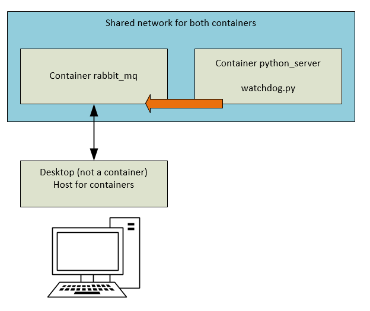
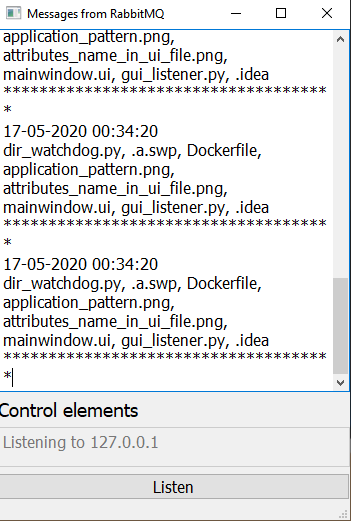

# Remote Directory Monitor

A client-server application for remotely monitoring the contents of a directory.

The server monitors a specified directory and sends notifications whenever its contents change. The client receives these notifications and displays updates almost immediately.

Communication between the client and server is implemented using **AMQP** and **RabbitMQ**.

## Technology Stack

- Python 3.7
- RabbitMQ
- PyQt 5.14 — graphical user interface
- Pika 1.1.0 — RabbitMQ client library
- Docker and Docker Compose

## Architecture

The project consists of two main components:

- **Server** — monitors a specified directory and sends change notifications to RabbitMQ.
- **Client** — connects to RabbitMQ, receives notifications, and displays them in a graphical interface.

The application uses Docker Compose to deploy the server-side components on a single host.



## Getting Started

### 1. Start the Docker Containers

Run the following command in the directory containing `docker-compose.yaml`:

```bash
docker-compose up -d
```

Two containers will be started in the same Docker network:

- **rabbit_mq** — starts RabbitMQ and creates a user named `user` with the password `user` using an initialization script.
- **python_serve** — provides the Python environment required to run the directory monitoring service.

### 2. Start the Server

Run the monitoring script inside the `python_serve` container:

```bash
python async_rabbitmq_sender.py path_to_follow rabbitmq_1 &
```

Replace `path_to_follow` with the directory you want to monitor.

The default RabbitMQ hostname inside the Docker network is `rabbitmq_1`.

### 3. Start the Client

On the host machine, run:

```bash
python gui_listener.py 127.0.0.1
```

The client connects to RabbitMQ through the host address `127.0.0.1`.

The GUI application uses multiple threads. A separate thread handles incoming messages from RabbitMQ.

## GUI

The client provides a graphical interface for displaying directory change notifications.



## How It Works

1. The server starts monitoring the specified directory.
2. When a file or directory is created, modified, or deleted, the server detects the change.
3. The server sends a notification to a RabbitMQ queue.
4. The client receives the notification and updates its interface.

To test the application, navigate to the monitored directory inside the `python_serve` container and modify its contents.

The client running on the host machine should receive the corresponding notifications almost immediately.